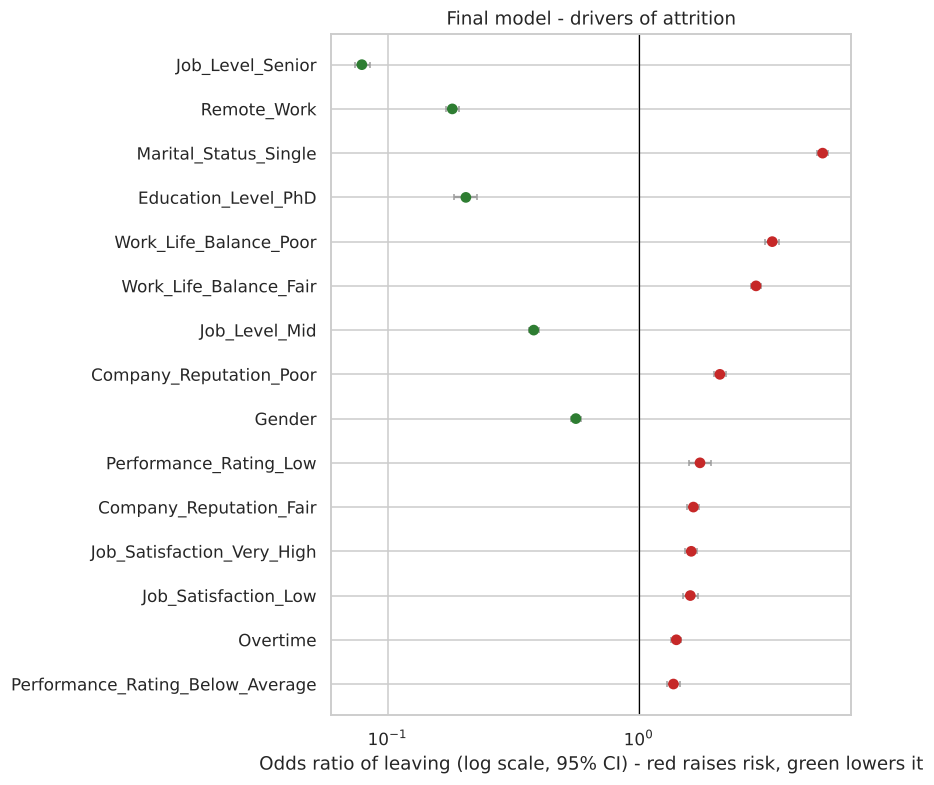
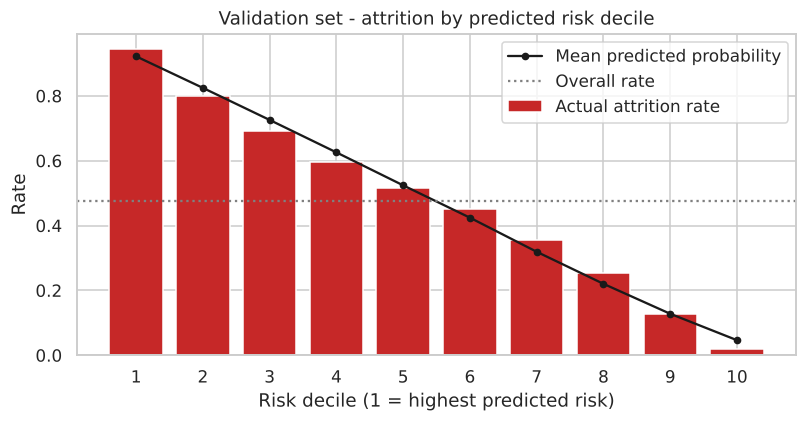

# Predicting Employee Retention with Logistic Regression

An interpretable attrition-risk model for HR, built on 74,498 employee records. The pipeline covers RFE feature selection, a statsmodels logit with p-value and VIF checks, cut-off selection, validation, and a risk-decile view that shows how HR would use the scores.

   

## Key results (validation set, 22,350 employees, cut-off 0.48)

| Metric | Train | Validation |
|---|---|---|
| Accuracy | 0.740 | 0.734 |
| Sensitivity (leavers caught) | 0.735 | 0.732 |
| Specificity | 0.745 | 0.735 |
| Precision | 0.722 | 0.714 |
| ROC-AUC | 0.826 | 0.825 |

| Benchmark (validation) | Features | ROC-AUC | Accuracy |
|---|---|---|---|
| **Pruned logit (this model)** | 15 | 0.825 | 0.734 |
| Logistic regression, all features (L2) | 41 | 0.840 | 0.748 |
| Gradient boosting | 41 | 0.847 | 0.752 |

**What drives attrition** (odds ratios from the final model)

| Lowers the risk of leaving | OR | Raises the risk of leaving | OR |
|---|---|---|---|
| Senior job level (vs entry) | 0.08 | Single (vs divorced) | 5.40 |
| Remote work | 0.18 | Poor work-life balance (vs excellent) | 3.40 |
| PhD (vs associate degree) | 0.21 | Fair work-life balance | 2.93 |
| Mid job level (vs entry) | 0.38 | Poor company reputation | 2.11 |
| Male (vs female) | 0.56 | Low performance rating | 1.75 |

**Findings**

1. Job level, marital status, remote work, work-life balance and education carry the signal. Income, age, tenure and distance add nothing once these are known.
2. The model generalises cleanly (train and validation within 0.01) and is **well calibrated**. The top risk decile has 94.5% actual attrition, the bottom decile 1.8%, and the top 30% of employees by risk includes 51% of all leavers.
3. Using all 41 features or gradient boosting adds about 0.02 AUC. For HR decisions, the shorter, explainable driver list is worth that cost.
4. **Deployment caution:** marital status and gender are strong predictors, but they must not drive decisions about individuals. A production version should be refitted without them and audited for fairness.

<p align="center">
   
</p>

## Approach (assignment structure)

1. **Data preparation:** inspect shape, types and summary statistics.
2. **Data cleaning:**
   - remove 112 exact duplicate rows
   - repair mis-decoded apostrophes in education labels
   - audit missingness against the target
   - flag inconsistent tenure fields
3. **Train/validation split:** stratified 70/30. Median imputation is fitted on the training set only.
4. **EDA on train:** distributions, correlations, class balance, attrition rate by category.
5. **Validation EDA check:** Kolmogorov-Smirnov tests and category-rate comparison.
6. **Feature engineering:** 0/1 binaries and dummy variables (first level dropped).
7. **Model building:**
   - standard scaling
   - RFE down to 15 features
   - statsmodels GLM with iterative p-value (< 0.05) and VIF (< 5) pruning
   - cut-off chosen where sensitivity equals specificity
8. **Validation:** accuracy, confusion matrix, sensitivity, specificity, precision and recall.
9. **Extensions:** odds-ratio forest plot, full-model and gradient-boosting benchmarks, and risk deciles.

## Repository structure

```
employee-retention-logistic-regression/
├── data/Employee_data.csv               # 74,610 rows, 24 columns
├── notebooks/employee_retention_logistic_regression.ipynb
├── outputs/figures/   outputs/metrics/
├── reports/Employee_Retention_Logistic_Regression_Report.docx
├── requirements.txt   LICENSE   README.md
```

## How to run

```bash
git clone https://github.com/kashiprasadtn/employee-retention-logistic-regression.git
cd employee-retention-logistic-regression
python -m venv .venv && source .venv/bin/activate   # Windows: .venv\Scripts\activate
pip install -r requirements.txt
jupyter lab notebooks/employee_retention_logistic_regression.ipynb
```

Run all cells (about 2 minutes). `random_state = 42` is used throughout.

## Limitations

- **Signs of synthetic data:**
  - For 84% of rows, `Years at Company` exceeds `Company Tenure`, which is impossible if both measure time at this company.
  - *Very high* job satisfaction raises attrition as much as *low* satisfaction does.
  - So the drivers may not transfer to a real workforce.
- A single snapshot with no time dimension, so the model cannot say *when* someone will leave.
- Median imputation discards a small missingness signal (missing tenure goes with lower attrition).

## Data and attribution

- **Dataset:** an employee attrition dataset (74,610 records, 24 attributes) supplied through upGrad coursework. A matching public version is available on Kaggle. It is included for educational, non-commercial use.
- This repository follows the upGrad *Predicting Employee Retention* assignment structure. The code, analysis, extensions and report are my own.
- Completed as part of the MS in Artificial Intelligence (Liverpool John Moores University, delivered via upGrad).

## Licence

Code is released under the [MIT License](LICENSE). The dataset is excluded.
